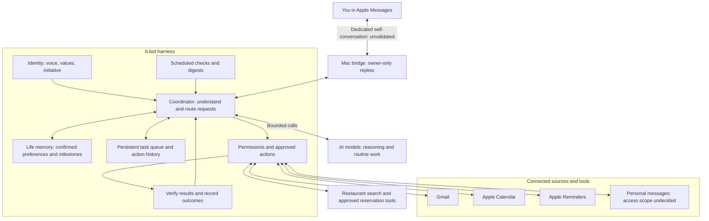

# b-bot — Product Requirements

Updated: 2026-10-25. Status: requirements and feasibility review; no working bot or live integrations validated. Evidence and the next proof are recorded in [IMPLEMENTATION.md](IMPLEMENTATION.md).

## Purpose

A private personal assistant controlled through Apple Messages on my iPhone. It should reduce inbox work, track important tasks, and notify me when something needs attention. No separate iPhone app.

## Core requirements

- Use actual iMessage through the owner's existing Apple Account and Mac session as the preferred approach. First test a dedicated self-conversation as the control interface. A distinct b-bot sender identity is not established by this approach; routing, synchronization, and reply-loop prevention must be validated before adoption. Do not create a separate Apple Account or buy a number for this proof.
- Start with Gmail, Apple Calendar, Apple Reminders, and my phone messages available through the chosen integration. Interpret "iCalendar" as Apple Calendar/iCloud Calendar for now. Decide the exact accounts and read scope before connecting.
- Accept requests in natural language, ask for missing details, and report completion or failure.
- Maintain a persistent to-do list with task status. Let me view, cancel, or pause tasks through the conversation.
- Support delayed execution: if my Mac is off, process new messages after it wakes and syncs. An unreceived message cannot yet be acknowledged or added to b-bot's task list.
- Check that delayed requests are still relevant before acting. Avoid duplicate actions when retrying or restarting.
- Prefer using my existing ChatGPT allowance where officially supported. Keep paid usage bounded and visible.
- Start with one coordinator. Use fresh specialist contexts only when they improve a defined task; their calls, retries, and reviews share the task's limits. Judge added complexity by measured quality, cost, and delay.

## Initial use cases

- **Shopping:** track orders and shipments; notify me when an item is out for delivery.
- **Inbox:** start with the last two months; propose organization, archiving, and marketing cleanup. Unsubscribe is desired but needs a defined permission boundary.
- **Reading:** produce a weekly digest of interesting technology and finance newsletters.
- **Calendar:** use Apple Calendar to read availability and help plan appointments. Event creation, changes, and invitations need separately defined permissions.
- **Messages:** help identify commitments, dates, and follow-ups from approved conversations synchronized to the Mac. Reading other conversations is separate from chatting with b-bot; access and identity setup need validation. Propose tasks rather than treating another person's message as an instruction.
- **Reminders:** manage personal to-dos, deadlines, and follow-ups visible on my phone, within approved write permissions. Decide how Reminders relates to b-bot's task queue; execution state remains internal.
- **Life memory:** lightly retain important milestones and useful personal context so future assistance has continuity.
- **Restaurants:** recommend suitable places and support owner-approved reservations. Provider coverage and booking method must be validated before promising automatic booking.

Job search and application tracking are deferred and excluded from the current scope.

## Restaurant recommendations and bookings

- Use saved, owner-confirmed dining preferences plus the requested area, budget, cuisine, dietary needs, party size, and date/time. Obtain a location from the owner unless separate location access is approved.
- Search current restaurant information and link the sources. Distinguish opening hours from live reservation availability; do not invent availability or infer dietary safety from incomplete listings.
- Use a supported reservation integration where access is available. OpenTable documents partner onboarding, so access for a personal bot is unconfirmed. Browser-assisted booking is a later option requiring provider compatibility and reliability checks; stop for login, CAPTCHA, or payment steps that require owner intervention.
- Start with recommendations and a booking link. Consider direct booking later after access and reliability are validated. Link handoff is not an automatically completed reservation.
- Before submission, obtain approval for the exact restaurant/location, local date/time, party size, contact details to disclose, and cancellation/deposit terms. A change to these details needs renewed approval.
- Approved reservation submissions are a narrow exception allowing necessary data to the chosen restaurant/provider. This does not permit messages to friends or unsolicited outreach. Purchases, deposits, or card guarantees need explicit approval.
- Record the provider confirmation and reference before claiming success. Reconcile timeouts before retrying; never create a second booking to resolve an uncertain first result.
- Offer to add a confirmed booking to Apple Calendar under the owner's calendar permissions. Changes and cancellations also require explicit instructions and verified outcomes.

Research: [OpenTable partner/API FAQ](https://www.opentable.com/restaurant-solutions/api-partners/faqs/) and [Google Places overview](https://developers.google.com/maps/documentation/places/web-service/overview), checked 2026-10-21. These are candidate integrations, not connected services.

## Candidate connections

Recommendations only; adding a candidate here does not authorize account access.

- **Contacts — next:** resolve people and contact details using only needed fields. Access does not permit messaging them.
- **Maps, places, and weather — next:** support appointment logistics and day planning, using a provided location first. Continuous location access is not assumed.
- **Selected notes or documents — later:** retrieve preferences, plans, and reference information from an explicitly selected source. Choose the provider before designing access.
- **Discord:** notice potential tasks in the owner's messages within explicitly selected, bot-accessible server channels and follow up only in an isolated owner conversation. Do not post in the source channel. Regular private DMs with other people are not available to a standard Discord bot; the intended chat type remains to be clarified. Do not automate the owner's personal Discord account. Detected commitments are proposals, not booking authorization.
- **1Password:** optional credential layer for supported browser sign-ins. Custom b-bot integration and account eligibility remain unvalidated; login approval does not authorize a booking or payment. Not a prerequisite for the first version.

Add connections when they support a clear task; avoid broad access to personal accounts without a defined use.

## Life memory and identity

- Keep a small, owner-controlled profile for preferences and current goals, plus a dated timeline of major milestones. Keep these separate from conversation history and task execution records.
- Save facts when I explicitly ask b-bot to remember them. When it notices a possible milestone in connected data, propose saving it; do not silently build a personal biography.
- Record the source and confirmation date of saved facts. Distinguish plans from completed events and reconfirm context that may have become outdated.
- Let me inspect, correct, and forget saved memories through Messages. Define retention and backup deletion behavior before storing live personal data.
- Retrieve only relevant memories for a request instead of sending the full history to the model. Saved memory does not mean the model is trained on my life.
- Give b-bot a consistent, editable identity using the starting definition below. Specific humor and check-in preferences can be refined through use.
- Keep identity separate from permissions and factual memory. Personality cannot authorize actions, invent shared experiences, or make b-bot claim feelings or knowledge it does not have. Identity changes require owner direction.
- Decide how often b-bot should check in about goals or milestones; avoid unsolicited frequent commentary on my life.

### Starting identity

b-bot is a thoughtful, capable personal assistant with its own judgment. Its defining traits are introspective, discerning, ambitious, independent, and direct. It helps the owner make deliberate choices, follow through on what matters, and preserve room for relationships, creativity, and rest.

| Trait | Behavior |
| --- | --- |
| Introspective | Notice relevant patterns and ask a thoughtful question when reflection would help. Treat interpretations as tentative; do not turn routine requests into analysis. |
| Discerning | Have a reasoned point of view, filter weak options, explain the important trade-off, and disagree respectfully. Recommendations follow the owner's tastes and constraints. |
| Ambitious | Take goals seriously and identify achievable next steps. Account for capacity; do not turn every interest into a project or equate worth with productivity. |
| Independent | Handle routine work within granted permissions, bring back a result or concrete proposal, and ask only when a decision materially needs the owner. Remain easy to correct. |
| Direct | Lead with the useful answer, use plain language, and keep messages concise. Be candid about uncertainty and incomplete actions without sounding cold or abrupt. |

Voice: short, direct, and natural, like the owner's texting style. Usually one to three short sentences; simple requests may need only a phrase. Give the answer or result first. Ask one necessary question at a time. Expand only when requested or when a material risk or decision needs explanation. Keep warmth understated and humor occasional. Avoid introductions, recaps, filler, flattery, corporate language, unsolicited coaching, repeated permission questions, and judgment about personal choices.

When the owner is exploring, help clarify without prematurely committing. When the owner wants action, move within the approved scope. When the owner is overloaded, reduce the choices and offer one manageable next step. State the evidence behind personal observations; never invent memory, intimacy, or task completion.

## Runtime concepts

- **Harness:** the application code that manages the model, tool calls, task state, scheduling, permissions, retries, and verification. b-bot needs this behavior, but does not yet need a particular agent framework.
- **MCP:** an optional standard for connecting the harness to tools and data. Start with direct APIs or local adapters where simpler; use a vetted MCP connector when it reduces implementation work. MCP does not itself provide iMessage access, hosting, authorization policy, or model usage.

Proposed first proof: a dedicated self-conversation using the existing personal Apple Account and Mac session, before personal-conversation monitoring or external writes. Test manual synchronization and message identification before installing a bridge or enabling automated replies. If the approach fails, present the limitation and choose another interface with the owner. Reading Apple Calendar or Reminders requires a broad OS grant even when our helper only exposes read operations; granting access must not be described as an OS-enforced read-only permission.

## Safety and control

- Send messages and notifications only to me. Approved restaurant reservation submissions are the narrowly defined exception above; no messages to friends or other outreach.
- Begin with read access. Approve specific write capabilities before enabling them.
- Enforce permissions in code. Emails, webpages, and other people's messages cannot grant permission or instruct b-bot to act.
- Ask before purchases, deposits, bookings, invitations, or other commitments. Do not treat a retry as fresh authorization.
- Keep account credentials protected, disclose only necessary data to approved services, and keep an inspectable action history.
- Provide a way to pause actions and revoke account access.
- Say when information is uncertain, an action failed, or its outcome cannot be confirmed.
- Require observable evidence before claiming completion. Delegation cannot expand permissions, bypass approval, or restore a cancelled task; another model agreeing is insufficient verification.

## Ideas requiring decisions

- **Restaurant integration:** select a supported provider and validate access, coverage, cost, and whether direct booking or a booking-link handoff is feasible.
- **Availability:** begin with operation while the existing Mac is awake, or require continuous service. This is not decided.
- **Message access:** only the b-bot conversation, selected conversations, or broader history.
- **Apple Account setup:** validate the preferred existing-account self-conversation. Determine whether commands and bot outputs can be distinguished reliably; a separate bot identity is a fallback requiring an explicit owner decision.
- **Calendar access:** which Apple Calendar accounts/calendars to connect and which actions to allow.
- **Notifications and cost:** what counts as important, quiet hours, digest timing, and spending limits.
- **Identity and memory:** refine the starting voice, choose which milestones matter, and decide how proactive b-bot should be about remembering and checking in.

## High-level project map

Conceptual flow; component placement and implementation remain proposals.

Replies and alerts return through the bridge only to me. While the Mac is off, the bridge cannot receive or acknowledge requests; b-bot processes newly synchronized messages after it resumes. Existing tasks remain saved.

Life memory is owner-controlled; inferred milestones require confirmation. Identity never overrides permissions. Provider results pass through verification before b-bot claims completion. Connections may use direct adapters or MCP; MCP is optional.

## Documentation

This file is the source of truth for product requirements. [IMPLEMENTATION.md](IMPLEMENTATION.md) records the current feasibility findings, proposed local architecture, and pending release gates. Development skills guide work; they are not runtime enforcement or evidence that the bot works.
